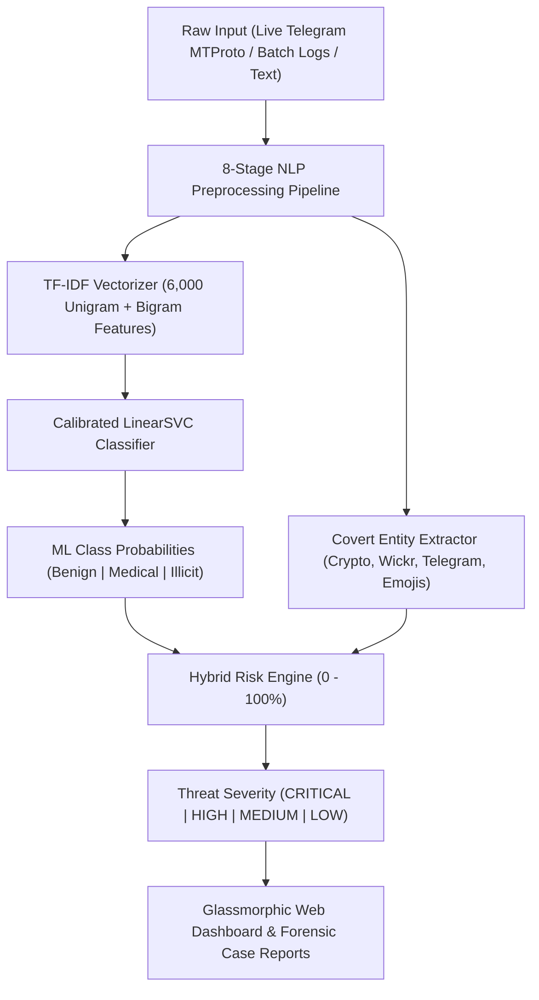

# 🛡️ Narcotrace (CyberNarc)
### AI-Powered Cyber Drug Trafficking Threat Intelligence & Digital Forensics Platform

[](https://www.python.org/)
[]()
[]()
[](LICENSE)

Narcotrace is an end-to-end, real-time **Cyber Threat Intelligence (CTI) & Digital Forensics Platform** designed to detect, intercept, and analyze illicit narcotics distribution networks across encrypted messaging platforms (Telegram), darknet forums, and social media.

---

## 📌 Problem Statement
Modern cyber drug syndicates evade conventional surveillance using sophisticated evasion techniques:
- **Emoji Ciphers:** Using `❄️` for cocaine, `💊` for prescription opioids, `🌿` for cannabis, and `🔌` for dealer/plug.
- **Street Slang:** Disguising transactions using street jargon (*"pure fishscale"*, *"loud pack"*, *"pressies"*, *"stealth drops"*).
- **Anonymous Cryptocurrencies:** Demanding payment in Bitcoin (BTC), Ethereum (ETH), and Monero (XMR).
- **The False-Positive Challenge:** Traditional keyword filters fail by flagging legitimate medical patients discussing prescription pain relief (e.g., Oxycodone, Adderall).

**Narcotrace solves this** with an **8-Stage NLP Preprocessing Pipeline**, a **Balanced 3-Class Classifier**, and a **Real-Time Telegram MTProto Interceptor**.

---

## 🚀 Key Features
- **📡 Real-Time Telegram Ingestion:** Connects directly to Telegram's encrypted MTProto socket via Telethon to intercept live messages on the fly.
- **🔬 8-Stage NLP Preprocessing Pipeline:** Automatically normalizes HTML, masks sensitive handles, decodes emoji ciphers into semantic drug tokens, normalizes street slang, and filters stopwords.
- **🎯 3-Class Balanced Classification:** Accurately distinguishes between *General / Benign Chats*, *Legitimate Medical Reviews* (UCI Drugs.com), and *Illicit Cyber Drug Trafficking*.
- **🏆 Calibrated Support Vector Machine:** Achieves **98.33% Accuracy** and **0.9833 F1-Score** using 6,000 TF-IDF unigram and bigram features with Platt probability calibration.
- **🔍 Covert Entity Extractor:** Deterministic regex DFA matcher extracting Telegram handles (`@username`), Wickr IDs, Session IDs, and crypto wallets (BTC, XMR, ETH).
- **⚡ Hybrid Threat Risk Engine:** Calculates a calibrated threat score (0–100%) categorized into `CRITICAL`, `HIGH`, `MEDIUM`, and `LOW`.
- **📂 Bulk Batch Log Analyzer:** High-throughput scanner capable of analyzing multi-line logs and CSV files in milliseconds.
- **📄 Law Enforcement Case Report Generator:** One-click generation of formal digital forensic dossiers with UTC timestamps and SHA-256 evidence integrity hashing.

---

## 🏗️ System Architecture



---

## 📊 Model Benchmark Evaluation

We evaluated 6 candidate machine learning classifiers on unseen test data (80/20 stratified split):

| Classifier | Accuracy | Precision | Recall | F1-Score | Status |
| :--- | :---: | :---: | :---: | :---: | :---: |
| **Support Vector Machine (Calibrated LinearSVC)** | **98.33%** | **0.9841** | **0.9833** | **0.9833** | 🏆 **Best Model** |
| **Logistic Regression (C=2.5)** | 97.92% | 0.9804 | 0.9792 | 0.9791 | Runner-Up |
| **Random Forest (150 Trees)** | 97.92% | 0.9797 | 0.9792 | 0.9793 | High Performance |
| **Neural Network (MLP 128x64)** | 97.92% | 0.9804 | 0.9792 | 0.9791 | High Performance |
| **Multinomial Naive Bayes** | 97.50% | 0.9763 | 0.9750 | 0.9748 | Fast Baseline |
| **Gradient Boosting Classifier** | 97.08% | 0.9715 | 0.9708 | 0.9706 | Baseline |

---

## 🛠️ Installation & Setup

### 1. Clone the Repository
```bash
git clone https://github.com/Anant-sketch/AI_DRUG_TRAFFICKING-.git
cd AI_DRUG_TRAFFICKING-
```

### 2. Set Up Virtual Environment
```bash
python -m venv .venv
# On Windows:
.venv\Scripts\activate
# On Linux / macOS:
source .venv/bin/activate
```

### 3. Install Dependencies
```bash
pip install -r requirement.txt
```

### 4. Configure Environment Variables
Copy `.env.example` to `.env`:
```bash
cp .env.example .env
```
Add your Telegram credentials (obtain from [my.telegram.org](https://my.telegram.org)):
```env
TELEGRAM_API_ID=your_api_id
TELEGRAM_API_HASH=your_api_hash
TARGET_CHANNELS=
```

---

## 💻 Running the Platform

### Option A: Launch the Web Dashboard
```bash
python app.py
```
Open your browser and navigate to:
```
http://127.0.0.1:5000
```

### Option B: Run the Live Telegram Scraper (CLI)
```bash
# Real-Time MTProto listening:
python scraper/telegram_scraper.py --live

# Interactive threat simulation demo:
python scraper/telegram_scraper.py --demo
```

---

## 📁 Project Directory Structure
```
AI_DRUG_TRAFFICKING/
├── app.py                      # Flask backend API & Web Server
├── run_telegram_demo.py        # Standalone scraper runner
├── requirement.txt             # Project Python dependencies
├── .env.example                # Template configuration file
├── database/
│   ├── mongo_manager.py        # MongoDB & Local JSON Dual-Persistence Manager
│   └── scraped_messages.json   # Threat intelligence records
├── dataset/
│   ├── dataset_loader.py       # Balanced 3-class dataset pipeline
│   ├── drug_data.csv           # Curated training data
│   └── preprocessed_data.csv   # Preprocessed vectorized corpus
├── engine/
│   ├── risk_engine.py          # Hybrid Threat Risk Scoring Engine (0-100%)
│   ├── report_generator.py     # Law Enforcement Forensic Case Report Generator
│   └── chat_engine.py          # Conversational assistant
├── extractors/
│   └── entity_extractor.py     # Regex DFA covert entity & crypto extractor
├── models/
│   ├── train_models.py         # Multi-model benchmarking & training script
│   ├── best_classifier.joblib  # Serialized Calibrated LinearSVC model
│   ├── tfidf_vectorizer.joblib # Serialized 6,000-feature TF-IDF vectorizer
│   └── metrics.json            # Model evaluation metrics & confusion matrices
├── preprocessing/
│   └── preprocess.py           # 8-Stage NLP Preprocessing Pipeline
├── scraper/
│   └── telegram_scraper.py     # Live Telethon MTProto scraper
└── static/
    ├── index.html              # Glassmorphic Web Dashboard UI
    ├── app.js                  # Frontend client logic & event listeners
    └── style.css               # Modern dark-mode forensic styling
```

---

## 📜 Disclaimer
*This project was developed for educational and digital forensics research purposes. All scraping tools comply with authorized test channels and standard security protocols.*
